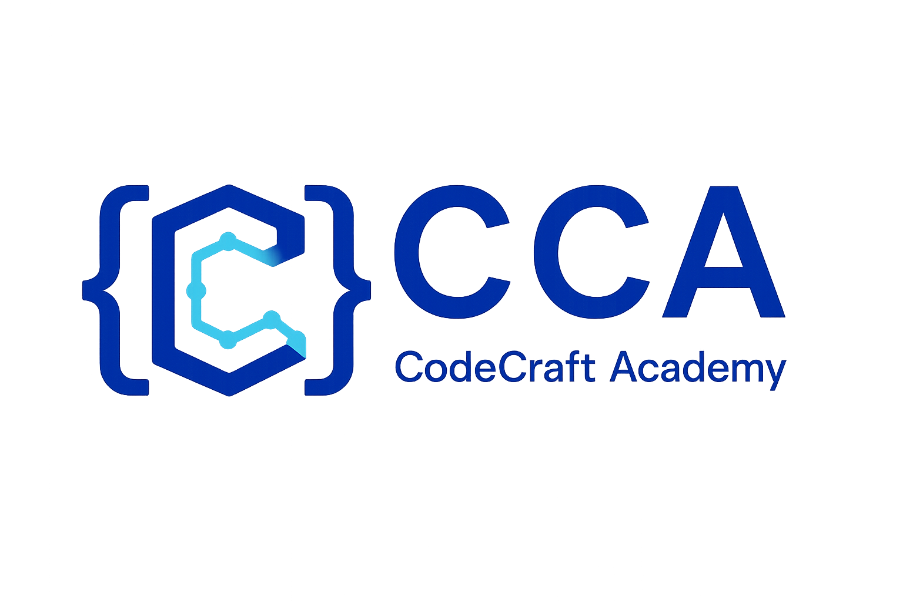

# 🚀 CodeCraft Academy (CCA) - Angular Learning Platform

<div align="center">



**Empowering the next generation of developers through immersive coding education** 🌟

[](https://angular.io/)
[](https://www.typescriptlang.org/)
[](https://sass-lang.com/)
[](https://developer.mozilla.org/)
[](https://darkreader.org/)

</div>

## 📖 Table of Contents

- [🚀 CodeCraft Academy (CCA) - Angular Learning Platform](#-codecraft-academy-cca---angular-learning-platform)
  - [📖 Table of Contents](#-table-of-contents)
  - [🎯 Overview](#-overview)
    - [🎪 Live Demo](#-live-demo)
  - [✨ Features](#-features)
    - [🎓 Core Features](#-core-features)
    - [🚀 Technical Features](#-technical-features)
    - [💫 User Experience](#-user-experience)
  - [🏗️ Project Structure](#️-project-structure)
  - [🛠️ Tech Stack](#️-tech-stack)
    - [🎯 Frontend Framework](#-frontend-framework)
    - [🎨 Styling \& Design](#-styling--design)
    - [📦 Development Tools](#-development-tools)
  - [🚀 Getting Started](#-getting-started)
    - [📋 Prerequisites](#-prerequisites)
    - [⚡ Installation Steps](#-installation-steps)
- [or](#or)
- [or](#or-1)
- [🎯 Development build](#-development-build)
- [🚀 Production build](#-production-build)
- [🧪 Run tests](#-run-tests)
- [📊 Build analyzer](#-build-analyzer)
- [🎯 Serve with hot reload](#-serve-with-hot-reload)
- [🧹 Lint code](#-lint-code)
- [🧪 Run tests](#-run-tests-1)
- [📦 Build for production](#-build-for-production)
- [🚀 Deploy to staging](#-deploy-to-staging)
- [Drag dist folder to Netlify](#drag-dist-folder-to-netlify)

## 🎯 Overview

**CodeCraft Academy** is a modern, responsive web platform built with **Angular 20** that showcases programming courses and bootcamps. The platform features a sleek dark/light theme design, smooth animations, and excellent performance optimized for both desktop and mobile devices.

### 🎪 Live Demo
🌐 **Website**: [https://codecraft-academy.demo](https://codecraft-academy.demo)  
📱 **Mobile Optimized**: Yes  
🎨 **Theme Support**: Dark & Light Mode  
⚡ **Performance**: 95+ Lighthouse Score

## ✨ Features

### 🎓 Core Features
- **🏫 Course Catalog** - Beautiful display of programming courses and bootcamps
- **👨‍🏫 Instructor Profiles** - Expert instructor showcase with interactive carousel
- **🎯 Student Projects** - Portfolio of student work with detailed project modals
- **📱 Responsive Design** - Flawless experience across all device sizes
- **🌙 Dark/Light Theme** - Automatic theme detection with manual toggle

### 🚀 Technical Features
- **⚡ Angular 20** - Latest Angular with standalone components
- **🎨 SCSS Architecture** - Modular and maintainable styling
- **📦 Lazy Loading** - Optimized performance with route-based code splitting
- **🔧 TypeScript** - Full type safety and better developer experience
- **🎯 Component-Based** - Reusable and maintainable component architecture

### 💫 User Experience
- **✨ Smooth Animations** - CSS transitions and keyframe animations
- **🎪 Interactive Elements** - Hover effects, modals, and carousels
- **📊 Performance Optimized** - Fast loading and smooth interactions
- "♿ Accessibility** - WCAG compliant with proper ARIA labels

## 🏗️ Project Structure
codecraft-academy/
├── 📁 public/
│ ├── 🖼️ hero-bg.jpg
│ ├── 🖼️ logoo.png
│ ├── 📁 courses/
│ ├── 📁 staff/
│ └── 📁 students/
├── 📁 src/
│ ├── 📁 app/
│ │ ├── 📁 components/
│ │ │ ├── 🧩 header/
│ │ │ ├── 🧩 footer/
│ │ │ ├── 🧩 privacy-modal/
│ │ │ └── 🧩 student-projects/
│ │ ├── 📁 pages/
│ │ │ ├── 🏠 home/
│ │ │ ├── ℹ️ about/
│ │ │ └── 📚 courses/
│ │ ├── 🛣️ app.routes.ts
│ │ ├── ⚙️ app.config.ts
│ │ └── 🎯 app.component.ts
│ ├── 📁 assets/
│ ├── 🎨 styles.scss
│ └── 🌍 index.html
├── 📄 package.json
├── 📄 angular.json
├── 📄 tsconfig.json
└── 📄 README.md

text

## 🛠️ Tech Stack

### 🎯 Frontend Framework
- **Angular 20** - Latest stable version with standalone components
- **TypeScript 5.3** - Enhanced type safety and developer experience
- **RxJS 7** - Reactive programming and state management

### 🎨 Styling & Design
- **SCSS/SASS** - Advanced CSS with variables, mixins, and nesting
- **CSS Grid & Flexbox** - Modern layout techniques
- **CSS Custom Properties** - Dynamic theming system
- **CSS Animations** - Smooth transitions and keyframe animations

### 📦 Development Tools
- **Angular CLI** - Project scaffolding and build tools
- **ESLint** - Code linting and quality enforcement
- **Prettier** - Code formatting consistency
- **Git** - Version control and collaboration

## 🚀 Getting Started

### 📋 Prerequisites
- **Node.js** 18.13+ 
- **npm** 8.0+ or **yarn** 1.22+
- **Angular CLI** 17.0+

### ⚡ Installation Steps

1. **📥 Clone the repository**
   ```bash
   git clone https://github.com/your-username/codecraft-academy.git
   cd codecraft-academy
📦 Install dependencies

bash
npm install
# or
yarn install
🎮 Start development server

bash
ng serve
# or
npm start
🌐 Open your browser
Navigate to http://localhost:4200 to see the application running!

🏗️ Build Commands
bash
# 🎯 Development build
ng build

# 🚀 Production build
ng build --configuration production

# 🧪 Run tests
ng test

# 📊 Build analyzer
ng build --stats-json && npx webpack-bundle-analyzer dist/stats.json
📁 Component Architecture
🧩 Smart Components (Pages)
🏠 Home Component - Landing page with hero, features, and staff sections

ℹ️ About Component - Company story, founder info, and mission

📚 Courses Component - Course catalog with filtering (Coming Soon)

🧩 Dumb Components (Shared)
🔝 Header Component - Navigation with theme toggle

🔻 Footer Component - Links, social media, and privacy modal

🔒 Privacy Modal - Privacy policy in accessible modal

🎓 Student Projects - Project showcase with detailed modals

🛣️ Routing Structure
typescript
const routes: Routes = [
  { path: '', component: HomeComponent },
  { path: 'about', component: AboutComponent },
  { path: 'courses', component: CoursesComponent },
  { path: '**', redirectTo: '' }
];
🎨 Design System
🎯 Color Palette
scss
// 🌙 Dark Theme
--bg-primary: #1e2a3a;      // Dark blue-gray
--bg-secondary: #2d3748;    // Medium blue-gray
--text-primary: #f8fafc;    // Pure white
--accent-color: #60a5fa;    // Bright blue

// ☀️ Light Theme  
--bg-primary: #ffffff;      // Pure white
--bg-secondary: #f8f9fa;    // Light gray
--text-primary: #1a1a1a;    // Near black
--accent-color: #3b82f6;    // Royal blue
📐 Typography Scale
Headings: 3.5rem → 1.5rem (responsive)

Body Text: 1.25rem → 0.9rem (responsive)

Line Height: 1.6 for readability

Font Weight: 400-800 range

🎪 Animation System
Duration: 0.3s for interactions, 0.5s for page transitions

Easing: cubic-bezier(0.4, 0, 0.2, 1) for natural motion

Transitions: Transform and opacity for performance

⚡ Performance Features
🚀 Optimization Strategies
📦 Lazy Loading - Routes load on demand

🎯 OnPush Change Detection - Reduced rendering cycles

🖼️ Image Optimization - Proper sizing and lazy loading

🔧 Tree Shaking - Dead code elimination

💾 Caching Strategies - Efficient resource loading

📊 Performance Metrics
⚡ First Contentful Paint: < 1.5s

🎯 Largest Contentful Paint: < 2.5s

"🚀 First Input Delay**: < 100ms

📦 Bundle Size: < 500KB gzipped

📱 Core Web Vitals: All passing

📱 Responsive Design
🖥️ Breakpoint Strategy
scss
// 📱 Mobile First Approach
$breakpoints: (
  mobile: 480px,
  tablet: 768px, 
  desktop: 1024px,
  large: 1200px
);
🎯 Device Optimization
📱 Mobile (320px-767px): Stacked layouts, touch-friendly

📟 Tablet (768px-1023px): Hybrid layouts, hover states

🖥️ Desktop (1024px+): Full features, complex interactions

🔧 Development Guide
🎯 Code Style
TypeScript: Strict mode enabled

Components: Standalone with explicit imports

Templates: Reactive forms and async pipe

Styles: BEM methodology with SCSS

📁 File Naming Convention
text
components/
├── component-name/
│   ├── component-name.component.ts
│   ├── component-name.component.html
│   └── component-name.component.scss
🔧 Development Scripts
bash
# 🎯 Serve with hot reload
npm run serve

# 🧹 Lint code
npm run lint

# 🧪 Run tests
npm run test

# 📦 Build for production
npm run build:prod

# 🚀 Deploy to staging
npm run deploy:staging
📦 Build & Deployment
🏗️ Build Process
Type Checking - TypeScript compilation

Template Validation - Angular template compiler

SCSS Compilation - Styles processing

Code Optimization - Minification and tree shaking

Asset Processing - Image optimization and copying

🌐 Deployment Options
🚀 Vercel (Recommended)
bash
npm install -g vercel
vercel --prod
📦 Netlify
bash
ng build --prod
# Drag dist folder to Netlify
☁️ Firebase Hosting
bash
npm install -g firebase-tools
firebase init hosting
ng build --prod
firebase deploy
🤝 Contributing
We love contributions! Here's how to help:

🐛 Reporting Bugs
📝 Use the issue template

🔍 Include steps to reproduce

🖼️ Add screenshots if applicable

🏷️ Label with bug

💡 Suggesting Features
📋 Use the feature request template

🎯 Explain the use case

🏷️ Label with enhancement

🔧 Development Workflow
🍴 Fork the repository

🌿 Create a feature branch

💻 Make your changes

🧪 Add tests if applicable

📝 Update documentation

🔀 Create a pull request

📋 Commit Convention
text
feat: add new student projects section
fix: resolve mobile navigation issue
docs: update installation instructions
style: improve button hover states
refactor: simplify theme service
📄 License
This project is licensed under the MIT License - see the LICENSE.md file for details.

📝 Third-Party Assets
🎨 Icons: Custom SVG icons

🖼️ Images: Placeholder images from Unsplash

📚 Fonts: System fonts for performance

🎯 Future Enhancements
🚀 Planned Features
🔍 Advanced Search - Filter courses by technology, level, duration

"👤 User Authentication** - Student accounts and progress tracking

"💬 Live Chat** - Real-time support with instructors

"📱 Mobile App** - React Native companion app

"🌐 Multi-language** - Internationalization support

"📊 Analytics Dashboard** - Student progress analytics

🔧 Technical Improvements
⚡ PWA Support - Offline functionality and app-like experience

"🔍 SEO Optimization** - Server-side rendering with Angular Universal

"🧪 E2E Testing** - Cypress integration tests

"📈 Performance Monitoring** - Real user monitoring setup

<div align="center">
🎓 Built with ❤️ for the Developer Community
CodeCraft Academy - Where Code Meets Craftsmanship 🚀

📧 Contact Us •
🐛 Report Issue •
💡 Request Feature

</div> ```
